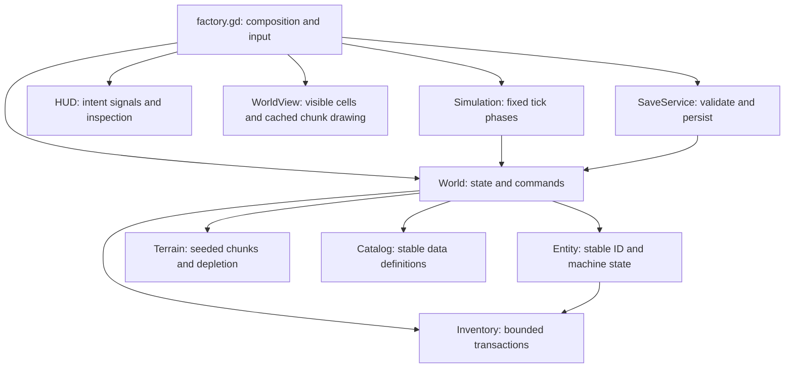

# Architecture

## Ownership and dependencies

The simulation and model use `RefCounted` objects and can run without a scene tree or rendering device. Views observe state; HUD signals and controller input call world commands. Saving is a boundary service. No simulation code reads UI nodes, frame time, keyboard state, or files.

| File | Responsibility |
| --- | --- |
| `factory.gd` | Compose a world, camera, view, and HUD; translate input; drive fixed ticks |
| `scripts/data/catalog.gd` | Stable item/building/recipe/technology IDs and definitions |
| `scripts/model/inventory.gd` | Bounded item counts; atomic exchanges; lossless partial transfers |
| `scripts/data/character_catalog.gd` / `scripts/model/character_progression.gd` | Personal stat definitions, material costs, progression gates, purchased ranks, and derived stats |
| `scripts/ui/character_panel.gd` | Engineer stat and purchase presentation inside the shared inventory workspace |
| `scripts/data/skill_catalog.gd` / `scripts/model/skills.gd` | Action XP, derived levels and milestones, movement-based discovery ledgers, and skill save validation |
| `scripts/model/entity.gd` | Persistent machine identity, inventories, timers, recipe, and hand |
| `scripts/model/terrain.gd` | Lazy deterministic terrain chunks; finite deposits; depletion overrides |
| `scripts/simulation/world.gd` | Authoritative state, occupancy/type indexes, construction and inventory commands |
| `scripts/simulation/inventory_transfers.gd` | Shared descriptor-based transfers, reach, filters, quotas, stale-target validation |
| `scripts/simulation/crafting.gd` | Atomic batch reservation, stable job IDs, exact-job and bulk refunds |
| `scripts/ui/inventory_workspace.gd` | Shared searchable pack, crafting, machine, and town workspace; see inventory-ui.md |
| `scripts/simulation/simulation.gd` | Belt, production, inserter, research, crafting, movement, and mining phases |
| `scripts/simulation/onboarding.gd` | Learning milestones, permanent action counters, content disclosure, objective targets |
| `scripts/data/settlement_catalog.gd` | Stable civic project, contract, hatch, and global effect definitions |
| `scripts/model/settlement_site.gd` | Persistent landmark inventory, repair state, and shipment state |
| `scripts/simulation/settlements.gd` | Settlement spatial indexes, repair economy, timed shipments, and derived civic effects |
| `scripts/simulation/defense.gd` / `scripts/persistence/defense_save.gd` | Voluntary beacon waves, deterministic lane combat, targeting, damage/recovery, and combat save invariants |
| `scripts/view/defense_view.gd` | Approach markers, scavenger rendering, and transient shot presentation |
| `scripts/persistence/settlement_save.gd` | Settlement extension validation and currency reconciliation |
| `scripts/ui/settlement_panel.gd` / `scripts/view/settlement_view.gd` | Town UI intent and procedural landmark presentation |
| `scripts/persistence/save_service.gd` | Schema validation, integer normalization, migration, transactional save writes |
| `scripts/view/terrain_chunk.gd` | Static chunk draw commands, invalidated on depletion |
| `scripts/view/world_view.gd` | View culling, cached terrain CanvasItems, animated machine/engineer drawing |
| `scripts/view/art.gd` / `machine_art.gd` / `engineer_art.gd` | Shared illustrated materials, machine silhouettes, and character poses |
| `scripts/view/landscape_view.gd` / `visual_effects.gd` | Decorative civic grounds and bounded action particles; presentation only |
| `scripts/ui/factory_hud.gd` | Toolbar, crafting, inspector, status; emits actions without implementing rules |

## State contracts

- String content IDs are serialized API. Preserve them when renaming display labels; migrate saves when changing IDs or rules.
- Entity IDs are monotonically assigned and never reused. `entities` owns objects; `occupancy` maps grid cells to IDs; `by_kind` holds IDs in stable order. Use `spawn/register/reclaim` to maintain all three indexes.
- Inventories count individual items with a total capacity. This is intentionally simpler than slot/stack inventories. `exchange` validates all ingredients and final capacity before mutating. `move_to` removes exactly what the receiver accepted. A future slot-based implementation can retain these operations.
- Machines separate **input inventory**, **output inventory**, and **inserter hand**. A recipe consumes inputs only upon completion, after verifying output room. Changing recipes atomically returns obsolete inputs, retains burner coal and energy, and clears work progress. Hand-craft jobs own reserved ingredients until completion or cancellation; stable monotonically increasing job IDs identify cancellation targets and persist across saves. Older queues receive IDs when loaded.
- Runtime intent (`move_direction`, current mining pointer) and presentation (`status`, selection, camera, interpolation) are transient. Item counts, progress, fuel energy, carried items, resource depletion, research, crafting jobs, ticks, and production totals are authoritative save state.
- New-game learning milestones and their action counters are also authoritative. They are recorded only by successful commands and production events. Content disclosure is enforced by build/craft commands and recipe selection as well as the HUD. `World.start()` creates an empty guided world; `World.new()` creates an unpopulated model for loading and focused tests. Demonstration factories live in `tests/fixtures.gd`.
- New machine behavior should be a phase/system operating on these records. Avoid one Node per belt item or a per-frame callback per machine.

## Tick contract

The simulation runs at **10 Hz**. The controller accumulates frame time, caps catch-up to 0.5 seconds per frame, and calls `Simulation.step`. Terrain and recipe generation never depend on render time. The engineer renders between previous/current tick positions; the camera follows smoothly.

The phase order is:

1. Increment world tick; resolve belt movement from a snapshot, reserving destinations before committing transfers.
2. Produce mine/recipe output and advance labs. Drills can eject an existing output item onto a belt after belt movement has completed.
3. Advance inserter pickup/drop cycles. Carried items remain owned by the hand across blocked drops and saves.
4. Advance beacon warning/combat after inserter deliveries, consuming real ammo and applying damage. Then dispatch/advance settlement shipments; a breached hub suspends the economy immediately. Reserve goods on dispatch and credit completed shipments exactly once.
5. Move the engineer, advance queued hand crafting, and mine by hand.
6. Notify observers at 2 Hz; explicit commands also notify immediately.

Each phase visits stable entity IDs. Load rebuilds type indexes in sorted ID order, so JSON record ordering cannot change arbitration. A save/restore continuation test compares full authoritative state with uninterrupted simulation. If phase order or durations change, review compatibility with existing work-in-progress saves.

The player can issue build/craft/inventory commands between ticks. This is a local single-player foundation, not a replay or multiplayer command log. A future deterministic replay layer should timestamp and enqueue these commands, and record input intent per tick.

## Terrain and scale

The illustrated art layer is separate from simulation terrain. Chunk-cached decoration uses seed-stable visual noise; roads and courtyard props do not change occupancy. Dynamic world objects sort by ground-contact depth. Inventory building icons reuse the machine renderer, and successful mining/repair signals drive a bounded particle pool. See [art-direction.md](art-direction.md).

New worlds select terrain generator 2 and a random seed. Versioned region-based deposits provide all four resources, irregular boundaries, and capped distance-based size/richness growth. Existing saves default to generator 1 to preserve their exact terrain. The on-demand resource survey queries live stock and emits a transient compass target. See [world-generation.md](world-generation.md) for generation contracts and seed reproduction.

Terrain uses **16×16** seeded chunks, supports negative grid coordinates, and generates only when queried. Depletion is stored separately from generated data; clearing a terrain cache cannot regenerate mined ore. Starting deposits are explicit tutorial anchors; additional patches derive from chunk coordinates and world seed. Terrain generation rules are part of save compatibility because saves store seed plus changes rather than every tile.

Static terrain draw commands are cached in chunk CanvasItems. Only visible cells are scanned for dynamic entities. Render chunk retention is bounded (64 cached nodes outside the currently visible set); generated terrain can be evicted after 128 chunks, while depletion overrides remain. Offscreen factories continue simulating.

Tick cost is currently O(belts + production machines + inserters + labs), with constant-time occupancy lookup. Memory scales with placed entities and depleted resource tiles, rather than the area explored. This is a foundation, not proof of Factorio-scale throughput: there is no sleeping-machine scheduler, transport-line compression, belt lanes, or worker-thread simulation yet. Profile actual large factories before adding these optimizations.

## Adding content

For a new recipe using an existing machine:

1. Add any new output item to `Catalog.ITEMS` with its stable ID/name/color.
2. Add `RECIPES[id]` with input/output dictionaries, duration in ticks, and machine ID. Add `hand: true` only if the engineer can craft it. Optionally name a prerequisite technology.
3. Add the recipe ID to the machine's `BUILDINGS[kind].recipes` list. The inspector offers an unlocked recipe picker; inserter input filtering follows the active recipe automatically.
4. Add quantity/timing/unlock checks to the integration tests. If changing saved state or procedural terrain, add a schema migration rather than silently interpreting old data differently.

For a new building behavior, add a definition/build recipe and a simulation phase or focused system. Register its transient indexes when spawning/loading/reclaiming. Rendering can draw a new icon without modifying recipe/transport rules. Persist only authoritative state, then validate and test its round trip and deterministic continuation.

## Persistence and tests

The optional `defense` extension stores warning, wave progress, pending arrivals, enemy IDs/positions/health, and timers. Entity records add health and turret cooldowns. Settlement extension 2 adds civic health and the Town Hall; extension 1 migrates only the missing ruin onto vacant land. Defeated structures retain their goods as repairable records. See [defense.md](defense.md).

The optional `skills` extension stores XP and unique area/patch discovery ledgers. Levels and bonuses are derived. Missing skills start at zero XP; craft jobs optionally include integer work remainders. Skill XP is awarded at successful action completion, while automated production and UI actions never grant it. See [skills.md](skills.md).

The optional `character` extension stores purchased personal upgrade ranks. Saves without it retain base stats. Loading derives inventory capacity before validating item counts, then checks upgrade prerequisites after restoring lessons, research, and settlement state. See [character-progression.md](character-progression.md).

Schema v2 validates known IDs, numeric ranges, capacities, coordinates, unique entity IDs/tiles, recipe ownership, research prerequisites and investments, crafting queues, and depletion bounds. JSON numbers are normalized back to integer counts/timers. A decoded world replaces the live world only after successful validation. The writer flushes a temporary file, preserves a backup, then renames the temporary file into the slot. File-system write/backup/rename failures are reported; there is no autosave or automatic backup recovery yet.

The optional `onboarding` v2 extension stores enabled state, action counters, and completed lesson IDs. Completed lessons must match definition order and satisfied goals. Saves from before this extension load with onboarding disabled, preserving their established factories without new lesson gates. Adding/reordering published milestone IDs requires a compatibility strategy, just as changing recipes or terrain does.

The optional `settlements` extension has its own schema version. It validates civic stock quotas, shipment timers, repair prerequisites, wallet reconciliation, and non-overlapping footprints. Saves predating the extension gain ruined landmarks on vacant land; existing construction and the engineer are preserved. Fixed landmarks live outside the craftable entity registry and connect to inserters through `World.logistics_receiver`. See [settlements.md](settlements.md) for the economy and extension rules.

`tests/factory_tests.gd` exercises behavior without rendering, plus a small scene/UI smoke test. `tests/capture_preview.gd` renders inspection/crafting previews. The legacy `verify_factory.gd` entry point remains usable.

## Factory expansion systems

Transport routing lives in simulation/transport.gd. It separates route candidates from snapshot reservation/commit, with persistent splitter alternation and receiver merge cursors. Underground ends pair through bounded spatial lookup; no hidden item inventory exists. Stable entity IDs determine arbitration across saves.

ConstructionPlans owns configuration-only clipboard records and validated persistent ghosts. Stamping is atomic; nearby construction calls the normal material-consuming World.build command. Rendering uses a bounded preview layer and cannot build or transfer items.

ProductionMetrics keeps at most 60 per-second buckets of actual production and selected consumption events. It is transient and resets its observation window on load. Research definitions carry prerequisite IDs; shared project selection banks consumed science under inactive IDs. Commissioning awards use stable persistent keys, independent of lifetime production counters and manual XP.

Settlement neighborhood level derives from completed housing deliveries, and bonuses derive from current service availability. No separate writable neighborhood count can drift out of sync. Optional v2 fields preserve existing worlds; all persistent extensions are validated before replacing the live world. See factory-expansion.md for controls and limits.
